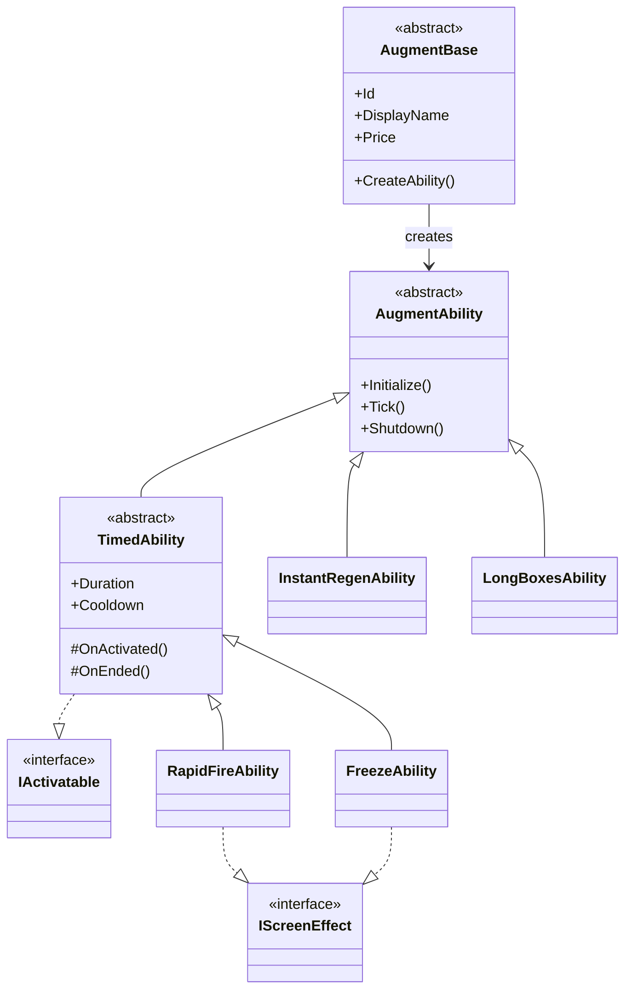
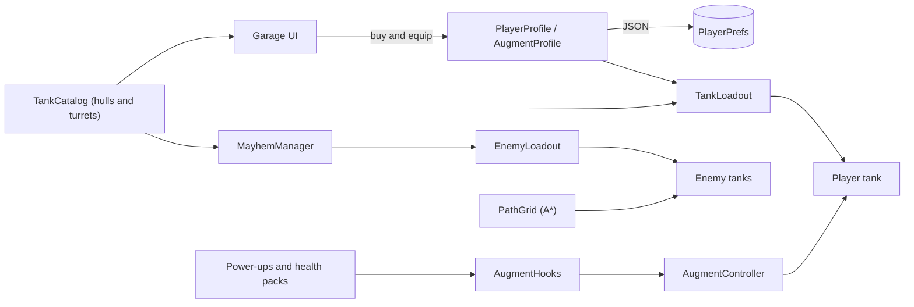

# Tank Arena

[](https://YOUR-USERNAME.itch.io/GAME-NAME)


A top-down 2D tank shooter built from scratch in **Unity 6** and **C#**. Build your own tank from interchangeable hulls and turrets, survive endless waves of enemy tanks, and spend the coins you earn on permanent upgrades.

## ▶ Play the game

**Play it for free on itch.io: [YOUR-USERNAME.itch.io/GAME-NAME](https://YOUR-USERNAME.itch.io/GAME-NAME)**

No installation is needed to try it. Your coins, parts and augments are saved between sessions. To explore the code or build it yourself, see [Getting started](#getting-started).

<!-- Add a gameplay GIF and 3-4 screenshots in a /docs folder, then uncomment:

| Garage | Mayhem wave | Augments |
|---|---|---|
|  |  |  |
-->

> Developed as a university project over one semester. All gameplay systems, tools and UI were implemented in C#.

---

## Contents

1. [Highlights](#highlights)
2. [Gameplay](#gameplay)
3. [Controls](#controls)
4. [Technical deep dive](#technical-deep-dive)
5. [Architecture](#architecture)
6. [Tech stack](#tech-stack)
7. [Project structure](#project-structure)
8. [Getting started](#getting-started)
9. [Assets and credits](#assets-and-credits)
10. [Limitations and future ideas](#limitations-and-future-ideas)
11. [Author](#author)

---

## Highlights

What this project demonstrates:

- **A\* pathfinding written from scratch:** grid-based search with a binary-heap open list, obstacle inflation by the tank's size, path smoothing, periodic re-planning and stuck recovery.
- **Wave-based game mode with scaling difficulty:** enemies spawn around the player, and their hulls, turrets, numbers and rewards progress with the wave.
- **Progression system with persistence:** a coin economy, 9 hulls, 9 turrets and 4 augments, saved between sessions.
- **Extensible augment system:** special abilities built on abstract classes and interfaces, so a new augment is one new file and no changes to existing systems.
- **Polymorphic part design:** every hull and turret is its own class deriving from a shared base, with different movement, firepower and bullet behaviors.
- **Production-style UI:** a pixel-art UI kit with 9-slice sprites, animated menus, a health bar with a damage trail, cooldown indicators and screen effects.
- **Custom editor tooling:** menu tools that generate maps and UI screens and wire every reference automatically, plus an in-game debug mode.

---

## Gameplay

You drive a tank in an enclosed arena. Enemy tanks hunt you, shoot back and fight for power-ups. Every enemy you destroy drops coins that you collect by driving over them. Between runs, you spend coins in the garage to build a stronger tank.

### Game modes

| Mode | Description |
|---|---|
| **Classic** | A few enemies at a time, spawning out of sight. Survive, collect coins and upgrade. |
| **Mayhem** | Endless waves close in from every side. Each wave brings more enemies using better hulls and turrets. Clearing a wave pays a coin bonus and drops a health pack. Your best wave is saved. |

The mode is chosen in the menu before picking a map. Both modes share the same maps, coins and upgrades.

### Build your tank

Hulls and turrets can be combined freely: **9 hulls × 9 turrets = 81 builds**.

- **Hulls** trade speed, turning rate and health, from the fast and fragile scout to the slow, heavily armored fortress.
- **Turrets** differ in damage, fire rate, range and bullet type:

| Bullet type | Behavior |
|---|---|
| Standard | A single shot, with variants such as rapid fire |
| Scatter | A fan of pellets |
| Burst | Several shots in quick succession |
| Piercing | Passes through several targets |
| Explosive | Area damage that falls off toward the edge |
| Electric | A zone of full damage with crackling lightning arcs |

The garage previews your tank with the turret following the mouse, and shows stat bars with colored `+/-` differences against the part you currently use.

### Augments

Equip **one** special ability, bought with coins:

| Augment | Effect |
|---|---|
| **Instant Regen** | Health packs heal you instantly instead of over several seconds |
| **Long Boxes** | Power-ups last 30 seconds instead of 15 |
| **Rapid Fire** | Press `E` to fire four times faster for a few seconds, with a glowing screen effect, then recharge |
| **Freeze** | Press `E` to freeze every enemy on the map, with an icy effect on each tank, then recharge |

Each augment has its own sound. A widget shows the equipped augment, with a cooldown sweep, a pulsing frame when it is ready and a ping when it recharges.

### On the battlefield

- **Power-up boxes:** double damage, double armor and double speed, each with its own icon and a timer card on the HUD. Tanks show a colored aura while an effect is active. Enemies deliberately go for nearby boxes.
- **Health packs:** heal over a few seconds with a green screen glow. Classic packs restore a fixed share of your maximum health. In Mayhem, packs get stronger and faster with every wave.

---

## Controls

| Input | Action |
|---|---|
| `W` / `Up` | Drive forward |
| `S` / `Down` | Drive backward |
| `A` `D` / `Left` `Right` | Rotate the hull |
| Mouse | Aim the turret |
| Hold `Left Mouse Button` | Fire |
| `E` | Use your augment |

In the browser, click inside the game once so it receives keyboard input.

---

## Technical deep dive

### Enemy behavior and pathfinding

Enemies are driven by a small decision cascade each physics frame:

1. A nearby **power-up box**: go for it (skipped if the effect is already active, or if the player is on top of them).
2. A wall between the enemy and the player: **follow a path** around it.
3. A clear view of the player: keep a **preferred distance** (approach, stand still, or back away so enemies never ram you).

The hull (physics, `FixedUpdate`) and the turret (visual, `Update`) are controlled independently. The turret turns at its own speed and only fires when it points at the target, is within range and has a clear shot, which is checked with a raycast against solid obstacles only.

**Pathfinding** (`PathGrid`):

- The map is converted into a grid of 0.5-unit cells. Every obstacle is **inflated by the tank's radius**, so any path that avoids blocked cells leaves room for the tank.
- **A\*** with 8-direction movement, an octile-distance heuristic, no corner cutting, and a hand-written **binary min-heap** for the open list. The search reuses its working arrays through a stamp trick, so a search allocates nothing.
- The raw grid path is **smoothed** by skipping every waypoint that can be reached in a straight, clear line.
- Enemies re-plan periodically (with random offsets so they don't all search in the same frame), cut corners while following, spread apart with a separation force, and **recover from being stuck** by reversing and re-planning.
- The grid was checked for connectivity against the generated map layouts, so no walkable area is cut off.

### Mayhem: wave system

- Enemies spawn on a ring around the player, on walkable cells outside the camera view, with a short flash before they appear.
- Wave `n` brings `6 + 2(n-1)` enemies, with more allowed alive at once and a faster spawn rate.
- **Difficulty progression:** the parts list is ordered by price. Each enemy rolls a hull and a turret around the current "level" (`(wave-1) × 0.8`), so wave 1 is almost only starter tanks and wave 12 is mostly the top tier. After that, enemies keep scaling in health and damage.
- Enemies are built at runtime from the same hull and turret classes as the player, with tuned strength multipliers. Rewards scale with the tier of the enemy.

### Garage and progression

- `HullBase` and `TurretBase` are abstract `ScriptableObject` classes; every part is its own subclass that overrides only its own numbers. Turrets can also override `Fire()` for special behavior.
- A static `TankCatalog` loads all parts, orders them by price and computes the maximum of each stat for the garage's bars.
- `PlayerProfile` and `AugmentProfile` store coins, owned parts and the equipped build as JSON in `PlayerPrefs`, and raise events when anything changes so the UI refreshes itself.
- `TankLoadout` dresses the player in the equipped parts when a map starts and applies their stats. `EnemyLoadout` does the same for enemies.

### Augment system

Augments are split into **data** and **behavior**, and the rest of the game talks to them only through interfaces:



- `TimedAbility` implements the whole *ready → active → cooling down → ready* cycle, the key handling and the sounds. A subclass only states its duration, cooldown and what it does.
- Optional interfaces let an augment plug into systems without those systems knowing about it: `IScreenEffect` (the HUD draws its glow), `IHealthPackModifier`, `IPowerUpListener` and `IFreezable` (implemented by enemy tanks).
- Existing systems call one-line `AugmentHooks`, never a specific augment.

Adding a new augment means writing one file:

```csharp
public class AugmentShield : AugmentBase
{
    public override string Id => "Shield";
    public override string DisplayName => "Shield";
    public override string CardName => "SHIELD";
    public override string Description => "Press E to take no damage for 4 seconds.";
    public override string Details => "TYPE: PRESS E";
    public override int Price => 1800;
    public override AugmentAbility CreateAbility() { return new ShieldAbility(); }
}

public class ShieldAbility : TimedAbility
{
    protected override float Duration { get { return 4f; } }
    protected override float Cooldown { get { return 60f; } }
    protected override void OnActivated() { /* make the player immune */ }
    protected override void OnEnded() { /* undo it */ }
}
```

The garage tab, HUD widget, sounds and key handling pick it up automatically.

### Combat

A shared `Weapon` component serves the player and every enemy. A turret decides *how* it fires (single shot, pellet fan, burst), and a `Bullet` decides what happens on impact (damage one target, pierce several, explode in a radius with distance falloff, or electrify an area). Bullets carry the tag of their shooter, so teams never hurt themselves. Power-ups and augments change shooting through multipliers on the weapon, not by editing it.

### UI and game feel

- A pixel-art UI kit with **9-slice sprites**, rendered at an integer pixel scale so borders stay crisp at any resolution.
- Animated menu panels (fade and slide with `CanvasGroup`), scene fades, and buttons that grow on hover, press down on click and play sounds.
- HUD: a health bar with a **damage trail** and color that changes with health, a pulsing red edge warning at low health, a kill counter that pops on every kill, power-up timer cards, a wave display with banners, and a death screen.
- Effects built in code (glows, rings, lightning arcs, frost) so they need no image files. Time-independent UI uses unscaled time.

### Editor tooling and debug mode

- **Editor tools** generate a complete map (ground, walls and a mirrored obstacle layout) and build the menu, HUD, garage, wave display and augment widget with every inspector reference wired up, so a new map or a redesigned screen takes seconds. Each tool is safe to run again.
- **Debug mode (`F2`)** gives a test panel for coins, health, power-ups, augments, hulls and turrets, enemy spawning, wave skipping and game speed. Click an enemy to see the route it is following drawn in the game view, toggle path tracking, view the navigation grid, and drag any tank to a new place. It exists only in the Unity editor and in development builds, so it is not part of the released game.

---

## Architecture



Principles used throughout:

- **Small, single-purpose components** combined on prefabs, with shared ones (`Weapon`, `Health`, `PowerUpReceiver`) used by both player and enemies.
- **Inheritance and interfaces** where behavior varies (parts, augments, freezable objects) and **composition** where it doesn't.
- **Events** for UI refresh instead of polling, and **static registries** for lookups such as "all enemies" or "all pickups".
- **Coroutines** for timed sequences, and `FixedUpdate` for physics, `Update` for input and visuals.

---

## Tech stack

| | |
|---|---|
| Engine | Unity 6 (2D) |
| Language | C# |
| Input | Unity Input System |
| UI | uGUI, TextMeshPro, 9-slice sprites, Canvas Scaler (1920 × 1080) |
| Animation | Animator controllers and sprite-sheet clips |
| Physics | Rigidbody2D, Collider2D, triggers, raycasts |
| Persistence | `PlayerPrefs` with `JsonUtility` |
| Version control | Git |

---

## Project structure

```
Assets/
├── Scripts/
│   ├── Player/        Movement, aiming, shooting, loadout
│   ├── Enemy/         Enemy behavior, pathfinding (PathGrid), spawning, Mayhem waves
│   ├── Parts/         Hull and turret base classes and one class per part
│   ├── Augments/      Augment base classes, interfaces and the four augments
│   ├── Pickups/       Power-ups, health packs, coins
│   ├── UI/            Menu, garage, HUD, effects
│   └── Core/          Game manager, profiles, catalog, sound helper
├── Editor/            Map generator, UI builders, setup tools
├── Resources/         Hull, turret and augment assets, coin prefab
├── Scenes/            MainMenu and the maps
├── Prefabs/           Player, enemy, bullet, pickups, effects
├── Textures/          Tanks, map, UI and pickup images
└── Audio/             Sound effects
```

---

## Getting started

**To play:** open the [itch.io page](https://YOUR-USERNAME.itch.io/GAME-NAME).

**To run it from source:**

*Requirements:* Unity 6 with the 2D module, plus the Input System and TextMeshPro packages.

1. Clone the repository and open the folder in Unity Hub.
2. Open `Assets/Scenes/MainMenu` and press **Play**.
3. In the menu, pick a mode (Classic or Mayhem) and a map.

Press `F2` in a map (editor only) for the debug panel, where coins, parts and augments can be unlocked to try everything quickly.

---

## Assets and credits

**Third-party assets**

- Tank sprites and effect sprite sheets: *[asset pack name]* by *[author]* — *[link]* — *[license]*
- Ground texture: *[source / link / license]*
- Pixel font *Thaleah Fat* by Rick Hoppmann — *[link]* — see the license included with the font

**Created for this project**

- The pixel-art UI kit, menu background, map textures (walls, crates, rocks, barrels, tank traps), power-up and health-pack box art, augment icons, bullet and coin sprites, and the sound effects.

---

## Limitations and future ideas

Known limitations:

- Mayhem enemies reuse the player's hull artwork with a red tint.
- Sound effects are simple placeholders, and there is no background music.
- Balance values were tuned by hand and could use more playtesting.

Ideas for future versions:

- Colored skins for hulls and turrets
- Moving hull and turret numbers into data files, so new parts need no code
- Boss waves and more augments
- More maps, difficulty options, and pause and settings menus

---

## Author

**[Your name]**
[Course / university, year] · [Email or LinkedIn] · [Portfolio link]
